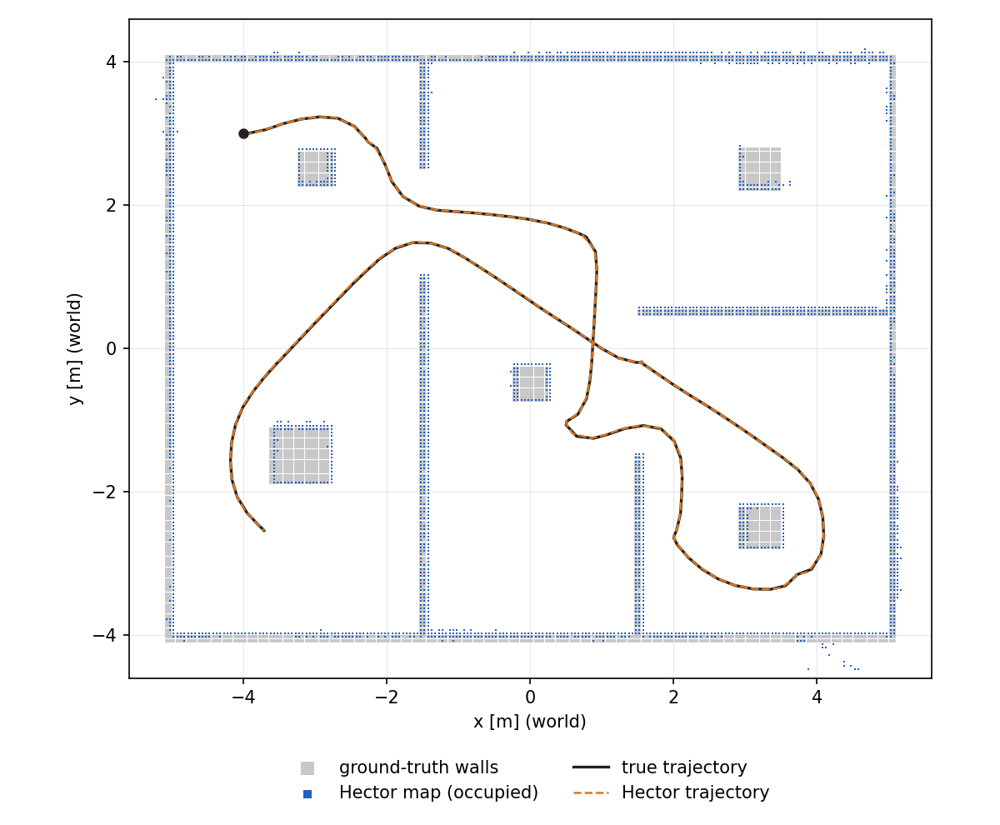

# TurtleBot Hector SLAM

Case study for **ICTE4001** (Curtin Colombo, Year 3): Hector SLAM on a
TurtleBot 4, integrated with Nav2 for autonomous navigation and frontier
exploration. The robot is simulated in [Webots](https://cyberbotics.com/); the
same launch files run on the physical TurtleBot 4.



_Autonomous exploration run: Hector's map (blue) over the true walls (grey),
Hector's pose estimate (dashed) over the true trajectory (black)._

## Repository structure

| Folder                                 | Purpose                                                                                       |
| -------------------------------------- | --------------------------------------------------------------------------------------------- |
| [`tb4_hector_slam/`](tb4_hector_slam/) | ROS 2 package: launch files, Hector + Nav2 config, RViz config, frontier explorer, saved maps |
| [`webots/`](webots/)                   | Webots world, TurtleBot 4 PROTO, ROS 2 bridge controller, ground-truth map, evaluation tools  |
| [`docs/`](docs/)                       | Case study brief, figures                                                                     |

How the pieces connect:

```
Webots (hector_slam_test.wbt)
   │  extern controller
tb4_ros2_bridge.py ── /scan, /odom, TF odom→base_link, /clock, /ground_truth/pose
   │                ◄─ /cmd_vel_unstamped
hector_mapping ────── /map, TF map→odom, /slam_out_pose
   │
Nav2 (planner, DWB controller, BT navigator, costmaps on /map + /scan)
   │  navigate_to_pose
frontier_explorer ─── picks the nearest reachable frontier on /map
```

## Setup (once)

Developed on Ubuntu 22.04, ROS 2 Humble, Webots R2025a (snap). **ROS 2 Jazzy
(Ubuntu 24.04) is also supported**: replace `humble` with `jazzy` in the
commands below (apt packages, `setup.bash`). `run_sim.sh` and
`setup_meshes.sh` now default to `/opt/ros/jazzy`; for Humble set
`ROS_SETUP=/opt/ros/humble/setup.bash` / `ROS_ROOT=/opt/ros/humble`.

**Velocity topic.** On Jazzy the Create 3 takes `/cmd_vel` as `TwistStamped`
and `geometry_msgs/Twist` on `/cmd_vel_unstamped`. Nav2's final output, the
frontier explorer and the Webots bridge therefore all use `/cmd_vel_unstamped`
(`navigation_launch.py` has a `cmd_vel_topic` argument to change it). Teleop:
`ros2 run teleop_twist_keyboard teleop_twist_keyboard --ros-args -r cmd_vel:=cmd_vel_unstamped`.
The Jazzy build of `hector_slam_humble` has not been tested.

```bash
sudo apt install ros-humble-navigation2 ros-humble-nav2-bringup \
                 ros-humble-turtlebot4-description ros-humble-irobot-create-description \
                 ros-humble-teleop-twist-keyboard python3-matplotlib
sudo snap install webots
```

### 1. Build Hector SLAM

Use the [TurtleBot-programming `hector_slam_humble`](https://github.com/TurtleBot-programming/hector_slam_humble)
fork. It has two fixes that are required here. Without the first, Hector gets
no scans. Without the second, the pose drifts sideways and the map is wrong.

- `/scan` subscription uses sensor-data (best-effort) QoS, matching the RPLIDAR and the Webots bridge.
- The `base_link → laser` transform is applied to every scan. The TB4 lidar is yawed 90°, and the original ROS 2 port ignored that.

```bash
mkdir -p ~/hector_ws/src && cd ~/hector_ws
git clone -b humble https://github.com/TurtleBot-programming/hector_slam_humble.git src
source /opt/ros/humble/setup.bash
colcon build
```

### 2. Build this package

```bash
cd ~ && git clone https://github.com/TurtleBot-programming/turtlebot-hector-slam.git
mkdir -p ~/tb4_slam_ws/src && cd ~/tb4_slam_ws
ln -sfn ~/turtlebot-hector-slam/tb4_hector_slam src/tb4_hector_slam
source /opt/ros/humble/setup.bash
source ~/hector_ws/install/setup.bash
colcon build --symlink-install --packages-select tb4_hector_slam
```

`--symlink-install` matters: without it config edits are not picked up until
the next build. Rebuild after changing C++ (`frontier_explorer.cpp`).

### 3. Environment for every ROS terminal

```bash
source /opt/ros/humble/setup.bash
source ~/hector_ws/install/setup.bash
source ~/tb4_slam_ws/install/setup.bash
```

## Running

Each block is a separate terminal. Always start the simulation first.

### Terminal 1: simulation

```bash
cd ~/turtlebot-hector-slam
./webots/run_sim.sh               # Webots GUI + ROS 2 bridge, robot driven by /cmd_vel
./webots/run_sim.sh --headless    # no GUI (faster, for batch runs)
./webots/run_sim.sh --patrol      # robot drives a fixed waypoint loop by itself
```

The first run copies the TurtleBot 4 meshes from `/opt/ros/humble/share`.
Wait for `extern controller: connected` in the output. Then check
`ros2 topic hz /scan` (~10 Hz).

Each start of `run_sim.sh` reloads the world, so the robot is back at its spawn
pose and the map starts empty. To start mapping from scratch, stop everything
(see [Stopping](#stopping)) and start again from terminal 1.

### Terminal 2: pick one mode

| Goal                                                            | Command                                                                                                                                                |
| --------------------------------------------------------------- | ------------------------------------------------------------------------------------------------------------------------------------------------------ |
| **Autonomous mapping** (SLAM + Nav2 + frontier explorer + RViz) | `ros2 launch tb4_hector_slam slam_nav_launch.py use_sim_time:=true explore:=true`                                                                      |
| Mapping + navigation, goals clicked in RViz (**Nav2 Goal**)     | `ros2 launch tb4_hector_slam slam_nav_launch.py use_sim_time:=true`                                                                                    |
| Mapping only, drive by keyboard                                 | `ros2 launch tb4_hector_slam hector_slam_launch.py use_sim_time:=true` then `ros2 run teleop_twist_keyboard teleop_twist_keyboard` in another terminal |
| Mapping only, scripted route                                    | `./webots/run_sim.sh --patrol` in terminal 1 + `hector_slam_launch.py use_sim_time:=true`                                                              |
| Nav2 only (SLAM started separately)                             | `ros2 launch tb4_hector_slam navigation_launch.py use_sim_time:=true`                                                                                  |

Do not combine `--patrol` with Nav2/`explore:=true`, since both would drive the robot.

Other launch arguments: `use_rviz:=false`, `rviz_config`, `params_file`,
`namespace`, `log_level`.

In autonomous mode the explorer logs `Exploring towards frontier (x, y)` for
each goal. It stops with `No reachable frontiers left: exploration complete`
(about 3 min of sim time for the test world).

### Terminal 3 (optional): record localisation error

```bash
python3 ~/turtlebot-hector-slam/webots/tools/pose_logger.py ~/pose_error.csv
```

This logs Hector's pose (`map → base_link`) against the simulator ground truth
once per second. Start it right after the launch and stop it with `Ctrl+C`.

### Save and evaluate the map

```bash
ros2 run nav2_map_server map_saver_cli -f ~/turtlebot-hector-slam/tb4_hector_slam/map/my_map \
    --ros-args -p use_sim_time:=true
python3 ~/turtlebot-hector-slam/webots/tools/evaluate_map.py \
    ~/turtlebot-hector-slam/tb4_hector_slam/map/my_map.yaml \
    --pose-log ~/pose_error.csv --plot ~/map_vs_ground_truth.png
```

`evaluate_map.py` compares the map with `webots/maps/ground_truth.pgm` and
prints wall precision/recall, free-space coverage and pose error. `--plot`
writes the overlay figure shown at the top.

### Stopping

`Ctrl+C` the launch terminal(s), then the `run_sim.sh` terminal (this closes
Webots). Check nothing is left over before the next run:

```bash
pgrep -fa "nav2|hector|rviz2|frontier_explorer|tb4_ros2_bridge"
```

### Physical TurtleBot 4

Full guide: [`docs/REAL_ROBOT.md`](docs/REAL_ROBOT.md) (setup, commands, what to tune).

Same launch files, without `use_sim_time`:

1. Laptop and robot on the same `ROS_DOMAIN_ID` and RMW; `ros2 topic list` shows `/scan`, `/odom`, `/tf`.
2. Undock, and stop anything else publishing `map → odom` (stock `turtlebot4_navigation` SLAM/localisation).
3. `ros2 launch tb4_hector_slam slam_nav_launch.py` (add `namespace:=/<ns>` for a namespaced robot, `explore:=true` for autonomous mapping).
4. Drive slowly at first. Hector uses scan matching only, so fast turns smear the map.

## Results (Webots, autonomous exploration)

Run of 2026-10-14: `slam_nav_launch.py explore:=true`, from spawn to "exploration
complete" in ~195 s sim time. Map: [`tb4_hector_slam/map/hector_map.*`](tb4_hector_slam/map/),
pose log: [`tb4_hector_slam/map/pose_error.csv`](tb4_hector_slam/map/pose_error.csv).

| Metric                                                | Value              |
| ----------------------------------------------------- | ------------------ |
| Wall precision (map wall within 10 cm of a true wall) | 99.2 %             |
| Wall recall (true wall within 10 cm of a map wall)    | 98.9 %             |
| Free space mapped                                     | 97.5 %             |
| Mean wall offset                                      | 2.3 cm             |
| Position error: mean / RMSE / max                     | 2.8 / 3.6 / 7.5 cm |
| Heading error: mean / max                             | 1.8° / 12.4°       |

The heading-error peaks come from turning on the spot. The logger compares the
latest TF with the latest ground truth, so the ~0.1 s scan interval shows up as
error while the robot rotates at up to 1 rad/s.

## Known limitations and troubleshooting

| Symptom                                                   | Cause / fix                                                                                                                                                                   |
| --------------------------------------------------------- | ----------------------------------------------------------------------------------------------------------------------------------------------------------------------------- |
| `/map` stays empty                                        | `hector_mapping` built without the QoS fix. `ros2 topic info /scan -v` must show the hector subscriber as `BEST_EFFORT`.                                                      |
| Map is skewed and the robot drifts sideways in the map    | `hector_mapping` built without the laser-transform fix (see Setup step 1).                                                                                                    |
| `Transform data too old when converting from odom to map` | Hector publishes `map → odom` once per scan (~0.1–0.3 s old). `transform_tolerance` is 0.5 s in `config/nav2.yaml`; don't lower it.                                           |
| Mirrored map / robot wobbles in place                     | The scan must be reversed (Webots orders rays clockwise). This is the default in the bridge; `--no-reverse-scan` turns it off for debugging only.                             |
| Nothing moves, TF lookups time out                        | Missing `use_sim_time:=true` in simulation.                                                                                                                                   |
| RViz freezes or is killed                                 | Very large maps. `map_size` is 512 (25.6 m); raise it only for larger spaces.                                                                                                 |
| Explorer goal times out                                   | Unreachable frontiers are blacklisted after `goal_timeout` (60 s), and the explorer moves on. Thresholds in `frontier_explorer.cpp` parameters are tuned for this world only. |
| Stale nodes from an earlier run                           | `pgrep -fa "nav2\|hector\|rviz2"`, then kill them before relaunching.                                                                                                         |

General limitations of Hector SLAM: there is no loop closure and no odometry
in the scan matcher. It relies on a fast, accurate lidar, and it degrades in
long featureless corridors and under fast rotation. Not yet tested on the
physical robot.

## Contributing

Create a branch, commit with a clear message, and open a pull request against `main`.
